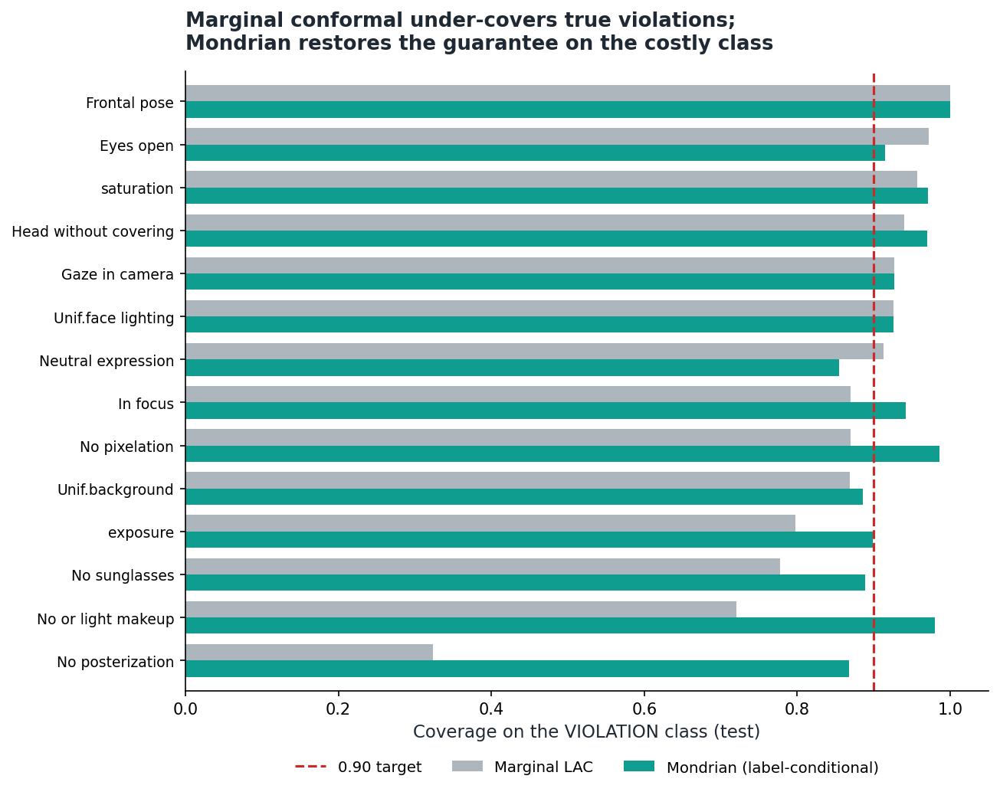
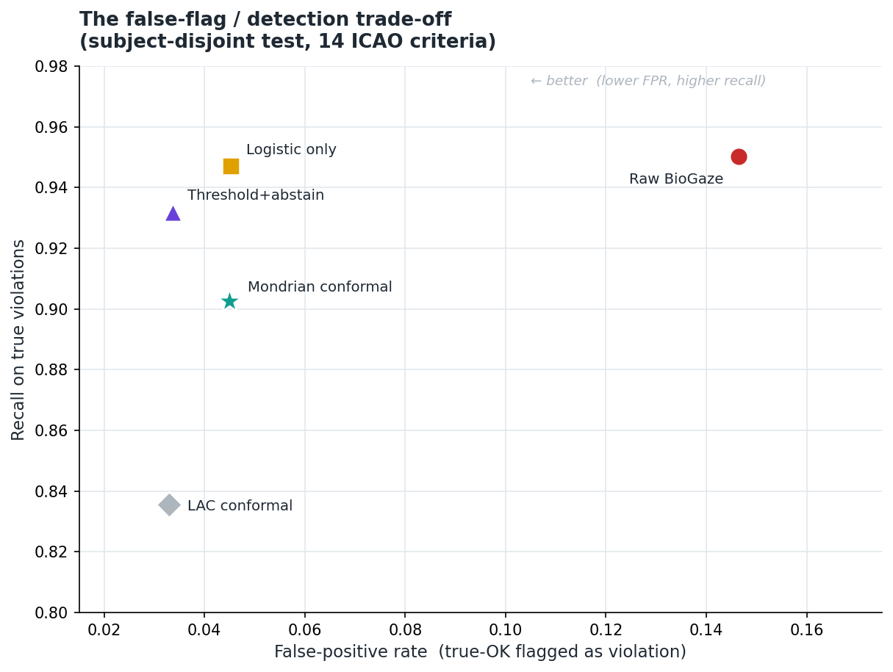
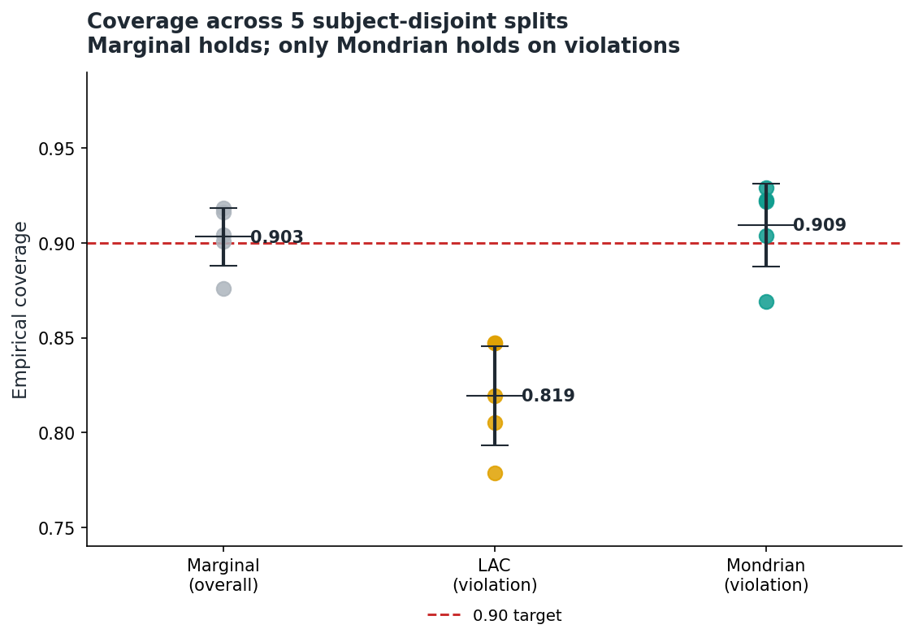
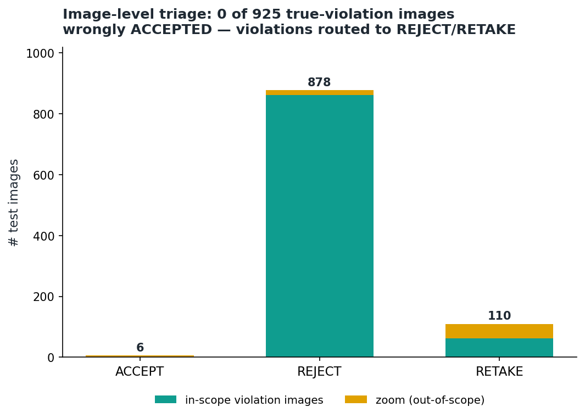

# Current version: v3 (hardened)

The authoritative paper and results are the **v3** set (`results_v3/Paper1_v3_draft.pdf`), produced after an internal multi-agent review. v3 adds Clopper-Pearson confidence intervals, a feature ablation (the coverage guarantee is feature-agnostic; accuracy is a single-violation artifact), an exact conformal quantile, a corrected randomized APS, honest subject-level and small-sample caveats, and a risk-coverage comparison. Reproduce with `./run_all_v3.sh`. The sections below describe the earlier v2 results.

---

# Uncertainty-Aware Triage for Rule-Based ICAO Face-Image Compliance

A model-agnostic **per-criterion calibration layer** on top of a rule-based ICAO/ISO
face-image compliance analyzer (**BioGaze**). It attaches a distribution-free
**coverage guarantee** to each per-criterion decision and turns the analyzer's hard
pass/fail outputs into an **ACCEPT / REJECT / RETAKE** triage under class imbalance and
asymmetric error cost.

**Author:** Mustafa Vedat Yıldırım — Oxford Brookes University, BSc Artificial Intelligence
**Supervisor:** Dr. Inna Skarga-Bandurova

---

## Headline results (TONO, 4,561 images, **subject-disjoint** evaluation)

All numbers are mean ± std over **five subject-disjoint splits** (identities partitioned, not
images — 247 of 275 identities appear across multiple violation folders, so a folder split
would leak identities into the test set).

- **Marginal coverage holds:** mean **0.903 ± 0.015** at a 0.90 target. (Our from-scratch LAC
  implementation matches MAPIE within 0.003.)
- **Marginal conformal under-covers the violation class:** mean violation-class coverage
  **0.819**, as low as **0.32** for one criterion — the cost-relevant quantity is *not*
  guaranteed by marginal conformal.
- **Label-conditional (Mondrian) conformal restores it:** violation-class coverage
  **0.909 ± 0.022**.
- **False-flag / detection trade-off (honest):** a plain logistic recalibration already
  removes **~69%** of BioGaze's per-criterion false flags (FPR 0.147 → 0.050) while keeping
  recall ~0.95; marginal LAC reaches the lowest FPR (~75% false-flag reduction) but sacrifices
  violation recall (0.81); **Mondrian** is the balanced point (~72% reduction, recall 0.88,
  violation-class guarantee kept). The reduction is **per-criterion false flags**, not image
  retakes.
- **Image-level safety:** **0 of 925** true-violation images are wrongly ACCEPTED; violations
  are routed to REJECT/RETAKE.
- **Joint-coverage caveat:** requiring all 14 sets to hold simultaneously gives ≈0.31 joint
  coverage (multiple-comparison effect); a Bonferroni per-criterion target of 0.993 would be
  needed for joint 0.90. Reported openly.






## Paper

Revised draft (methodology & results, honest metrics, 5 methods compared, Mondrian, 6 figures
+ 2 tables): `results_v2/Paper1_v2_draft.docx` / `.pdf`. The Introduction/Related Work are a
sketch pending agreement on the final experimental protocol.

Meeting note for the supervisor (what changed, DFIC plan, open methodological questions):
`results_v2/Meeting_Note_for_Inna.md`.

## Data & scope

[TONO synthetic dataset](https://miatbiolab.csr.unibo.it/tono-synthetic-dataset/) (MI@BioLab,
University of Bologna; CC BY-NC 4.0), single-violation partition. The full TONO→ICAO→BioGaze
mapping (16 in-scope folders → 14 criteria) and the out-of-scope treatment of `zoom`
(head-size/framing, which BioGaze does not check) are documented in
`results_v2/mapping_and_scope.md` and `results_v2/mapping_table.csv`. The dataset itself is
**not** redistributed here.

## Method

1. **BioGaze** ([repo](https://github.com/Maphoz/BioGaze)) → per-image 14 binary ICAO
   decisions + continuous metrics. `batch_predict.py` (resume + per-image timeout).
2. **Subject-disjoint** 60/20/20 split by parsed identity (`analysis_v2.py`,
   `split_manifest.json`).
3. Per-criterion probabilistic classifier + split conformal, **marginal LAC and Mondrian**
   (label-conditional), implemented from scratch and cross-checked against MAPIE.
4. Five triage strategies compared: raw rules, logistic-only, threshold+abstention, marginal
   LAC, Mondrian.

## Reproduce

```bash
pip install -r requirements_analysis.txt
# BioGaze predictions (needs the BioGaze stack: torch, dlib, mediapipe, ultralytics, rmn):
#   python batch_predict.py -i <TONO/release> -o tono_full_pred.csv
./run_all_v2.sh tono_full_pred.csv     # analysis + robustness + image-level + mapping + figures
```

Outputs land in `results_v2/`: `summary_v2.json`, `robustness_v2.json`, `image_level_v2.json`,
`per_criterion_v2.csv`, `mapping_table.csv`, `split_manifest.json`, four figures (PNG+SVG), and
the paper.

## Explainability

Region-level explanations (BiSeNet segmentation + 68 landmarks) faithful to the rule-based
decisions (`results/xai/xai_panel.png`, `make_xai_panel.py`).

## Next steps (Paper 2)

- Real, multi-attribute validation (**DFIC**) with a genuinely-compliant ACCEPT class.
- Cost-calibrated RETAKE region (asymmetric miss/retake cost) and a corrected joint guarantee.

## License / attribution

Research code, non-commercial. BioGaze and TONO retain their own licenses; cite TONO
(Borghi et al., ECCV 2024 Workshops) and BioGaze (FG 2025) if used.
